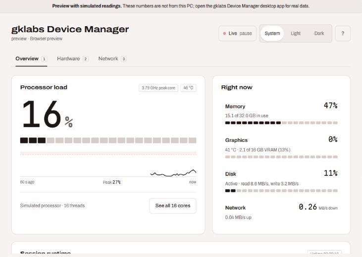
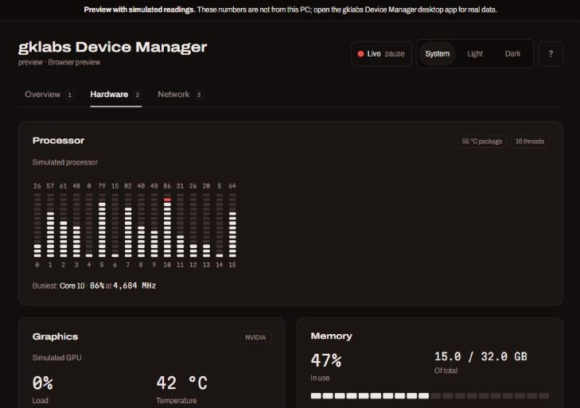
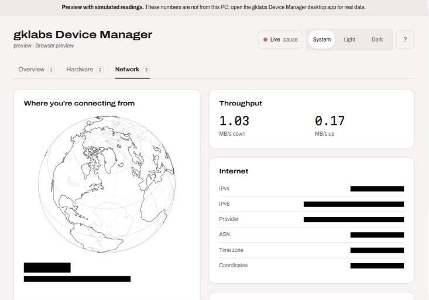

# gklabs Device Manager

A desktop system monitor that shows what your PC is doing right now and what it did a minute ago: processor load with a 60-second trail, every core on its own scale, NVIDIA GPU telemetry, memory, drives, disk activity, network throughput, scheduler counters, a session odometer, and a globe that marks where your connection comes from.

Built with Tauri 2, React and Rust by gkson.



| Hardware, dark theme | Network (personal details blacked out) |
| --- | --- |
|  |  |

The screenshots come from the browser preview, which runs on simulated readings and says so in the banner at the top.

## Pick your version

| System | Guide | Start it with |
| --- | --- | --- |
| Windows 10 / 11 | [README-windows.md](README-windows.md) | double-click `start.bat` |
| Linux (Ubuntu, Fedora, Arch, openSUSE, WSL) | [README-linux.md](README-linux.md) | `./start.sh` |
| macOS 11 or newer | [README-macos.md](README-macos.md) | `start-mac.command` on the `expansion-pack/macos` branch |

Each guide covers prerequisites, what each reading is based on, and troubleshooting for that system.

## What's inside

- **Overview:** the processor readout and its trail, then memory, graphics, disk and network in one list. Click any row to open its details.
- **Hardware:** every logical core on its own scale (hover, or use the arrow keys, for exact load and clock), GPU detail, memory and swap, each drive's fill, disk throughput and scheduler counters.
- **Network:** the globe, your public IP details, Wi-Fi link, router, DNS and live throughput.
- **Themes:** System, Light or Dark, remembered between launches.
- **Pause:** freeze every reading to read or screenshot it (P, or the status button).
- **Keyboard:** 1 to 3 switch views, T cycles the theme, F opens the facts drawer, ? lists every shortcut.

There are hidden achievements. No hints here.

## Expansion pack: Multi-PC

This branch adds a **Machines** tab (key 4) for watching every PC in the house from one screen, or from your phone.

1. On each PC you want to watch, open **Machines** and turn on **Let devices on my network see this PC's readings**. Windows may ask once to let the app through its firewall; allow it on private networks.
2. Copy the link it shows (`http://<address>:47823/#token=...`).
3. **On a phone:** open the link in the browser for a live, phone-sized page.
4. **On another PC:** paste the link into **Add a machine**. Each machine gets its own live card, next to This PC.

Sharing is off until you turn it on. The server only answers requests that carry the PC's private token, and **New token** makes every old link stop working. Machines you add are remembered on that PC only.

## How it works

A Rust thread collects readings twice a second and pushes them to the window as an event; the interface only listens. Per-platform data sources live in `src-tauri/src/lib.rs` (Windows) and `src-tauri/src/linux.rs` (Linux). The interface is in `src/`, and the design decisions behind it, with a reason for each, are in [DESIGN.md](DESIGN.md).

## Development

```bash
npm install
npm run tauri dev     # desktop app with live data
npm run dev           # browser preview with simulated readings
npm run tauri build   # release build
```
